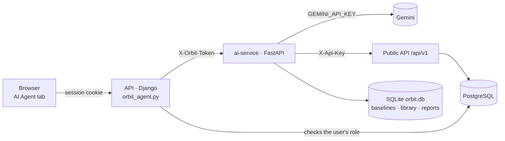
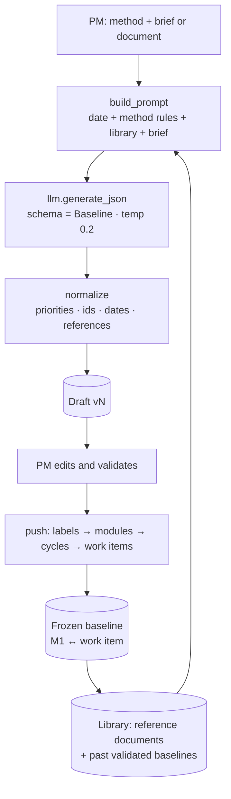
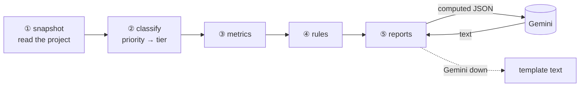
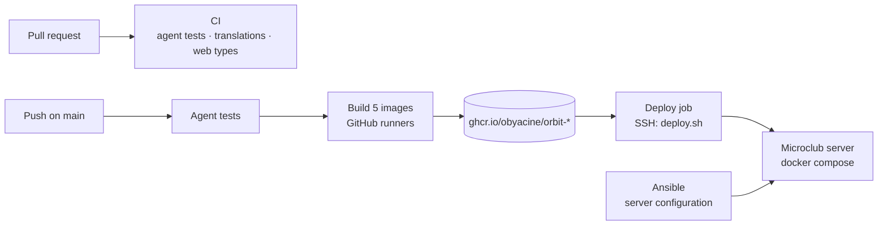

# Orbit — AI project-management agent

> Hackathon project · *AI for Work and Business*
>
> *Give us your project brief. We handle the paperwork, watch the project and draft the reports. You make the decisions.*

Orbit is a self-hosted project-management platform with a built-in AI agent for project managers.

1. **Kick-off.** The PM picks a method, pastes a brief or drops a specification document. The agent drafts the
   charter, the risk register, the breakdown and the prioritized deliverables, following the organization's own
   templates and past projects. The PM edits and validates: the **baseline** is frozen and created in the
   platform as work items, modules and cycles.
2. **Execution.** The team works as usual. The agent compares the live project with the baseline, flags drifts
   the moment they appear, and drafts the reporting chain **Team Lead → Project Manager → Steering Committee**.

Four rules shape the whole design:

| Rule | What it means in practice |
|---|---|
| **No method imposed** | 8 prioritization methods (MoSCoW, Kano, RICE, WSJF, ICE, value/effort, native priority, custom labels) × 4 delivery methods (Scrum, Kanban, Waterfall, hybrid). Rules and reports adapt. |
| **Numbers are computed, never generated** | Percentages, velocity, delays and anomalies come from tested Python code. The LLM only writes prose from that JSON. |
| **Humans decide** | Baselines and reports are drafts until a person validates them. Nothing reaches the platform without that click. |
| **Works without AI** | If the LLM is down, reports fall back to deterministic templates; every call has a timeout and a fallback model. |

---

## Contents

1. [What the PM does](#1-what-the-pm-does)
2. [Architecture](#2-architecture)
3. [The AI agent in detail](#3-the-ai-agent-in-detail)
4. [Security model](#4-security-model)
5. [Run it locally](#5-run-it-locally)
6. [CI/CD and production](#6-cicd-and-production)
7. [API reference](#7-api-reference)
8. [Tests](#8-tests)
9. [Repository layout](#9-repository-layout)
10. [Troubleshooting](#10-troubleshooting)
11. [Status, limits and roadmap](#11-status-limits-and-roadmap)
12. [License](#12-license)

---

## 1. What the PM does

Everything happens in the project's **AI Agent** tab (project menu → *AI Agent*), which has two steps.

### Step 1 · Cadrage (kick-off)

| Action | Result |
|---|---|
| Choose the method at the top of the page (e.g. *Scrum + MoSCoW*), click *Appliquer* | The method drives what the AI generates and how the project is monitored |
| *Organization library*: add reference documents once (charter template, past project documents, internal standards) | Every future kick-off follows their structure, vocabulary, usual deliverables and risks |
| Paste a brief, or *Import a document* (PDF, Word `.docx`, `.txt`, `.md`, drag and drop) | The extracted text lands in the brief, visible and editable: it is exactly what the AI receives |
| *Générer le cadrage* (≈ 10–15 s) | Draft: charter (context, budget, dates, objectives, success criteria, scope in/out, stakeholders, constraints), risk register, epics or phases, sprints, prioritized deliverables. The draft shows *"Inspired by: …"* |
| Edit deliverables (title, priority, epic, sprint, due date, add, remove) | — |
| *Valider et créer dans Orbit* | The baseline is frozen and versioned; labels, modules, cycles and work items `[M1] …` are created; the baseline joins the library as a past project |

### Step 2 · Pilotage (execution)

| Action | Result |
|---|---|
| *Analyser* | Weather 🟢🟡🔴, progress, velocity or throughput, WIP, anomaly register, plan vs actual, coverage per priority |
| *Rapport d'avancement* (Team Lead → PM) | Draft written by the AI from computed numbers; *Modifier* then *Valider* |
| *Rapport COPIL* (PM → Steering Committee) | Built on the latest **approved** progress report: weather, plan vs actual, anomalies, executive summary, recommendations |

Each anomaly names what it violates, e.g. `Baseline M2 · MoSCoW / Must-Have` or `Phase / Specifications`.

---

## 2. Architecture



### The platform

A monorepo of independent services (pnpm workspaces + Turborepo for TypeScript, uv for Python).

| Service | Stack | Role | Dev port |
|---|---|---|---|
| `apps/web` | React 19, React Router, MobX, Tailwind | Main application, including the *AI Agent* tab | 3000 |
| `apps/admin` | React | Instance administration (`/god-mode`) | 3001 |
| `apps/api` | Django, Django REST Framework | REST API, authentication, business logic, **agent proxy** | 8000 |
| worker / beat-worker | Celery + RabbitMQ | Activity history, notifications, webhooks, e-mails, scheduled jobs | — |
| `apps/live` | Node, Hocuspocus, Yjs | Real-time collaborative editing of documents | 3100 |
| `ai-service` | FastAPI, Python 3.12 | **The AI agent** | 8001 |
| PostgreSQL · Valkey · RabbitMQ · MinIO | — | Data, cache, queue, file storage (S3-compatible, pre-signed uploads) | 5433 · — |

**Data model.** Everything is scoped *Workspace → Project → Work item*. A work item has a state, priority,
assignees, labels, dates and relations (*blocks*, *blocked by*…); readable IDs such as `BANK-12` come from a
per-project sequence. *Cycles* are time boxes (sprints, milestones), *modules* group work items (epics, phases).

**Request lifecycle.** Dragging a card updates the MobX store at once (optimistic UI), then
`PATCH /api/workspaces/{slug}/projects/{id}/issues/{issue}/` runs with the session cookie; Django checks the
session and the role (Admin 20, Member 15, Guest 5), saves, answers, and queues the activity job for Celery.

### How the agent maps to the platform

| Agent concept | Platform object |
|---|---|
| Epic | Module |
| Phase (Waterfall, hybrid) | Module with start and end dates |
| Sprint / milestone | Cycle |
| Priority | Label (`Must`, `Basique`, `WSJF:13`…) or the native priority field |
| Blocked item | `blocked_by` relation or `Bloqué` label; the last comment is the reason |
| Done / in progress | State group `completed` / `started` |
| Baseline deliverable `M1` | Work item `[M1] …`, linked in the baseline record |

The platform stays the single source of truth for the work. The agent owns the baselines, the library and the
reports, stored in its own SQLite file: no platform database migration is needed.

---

## 3. The AI agent in detail

Code: [`ai-service/app/`](./ai-service/app). Gemini is reached only through `llm.py`.

### 3.1 Module 1 — brief to baseline



| Step | File | What happens |
|---|---|---|
| Document import | `module1/documents.py` | `pypdf` (page by page) and `python-docx` (paragraphs **and tables**), `.txt`/`.md` decoding; clear errors for scans without text, password-protected PDFs, unsupported formats, files over 10 MB; text capped at 60 000 characters. Nothing is stored. |
| Library | `db.py` (`reference_documents`, `past_validated_baselines`) | Reference documents with a role (*template*, *past project*, *internal standard*); the last 3 validated baselines of other projects are added automatically. |
| Prompt | `module1/baseline.py` → `build_prompt`, `reference_section` | Built by code for the PM's method: allowed priority values (or the score formula for RICE/WSJF/ICE), sprints or phases, id convention, size rules, then the library (12 000 characters per document, 36 000 in total, past projects summarized), then the brief between `"""`. Rule given to the model: *reuse the structure and habits of the references, never copy their facts — facts come only from the brief.* |
| Generation | `llm.py` → `generate_json` | System instruction "senior project manager… never invent a budget, date or name absent from the brief, write *À préciser*", temperature 0.2, **response schema imposed** (`Baseline` pydantic model): the answer is a typed object, not free text. |
| Correction | `normalize` | Unknown priority → allowed value; unknown epic → first epic; invalid dates dropped; sprints removed for Kanban/Waterfall; MoSCoW ids renumbered by category (`M1`, `S1`, `C1`, `W1`); scores parsed (`"8,5"` → `8.5`). |
| Validation | `push`, `db.validate_baseline` | Creates labels (reusing existing ones), modules (dated for phases), cycles, work items `[id] title` with label and native priority; stores the deliverable → work item map; the baseline becomes read-only. A project has one validated baseline; drafts are versioned. |

### 3.2 Module 2 — monitoring and reports



Steps ① to ④ contain **no LLM call**.

* **Methods → tiers** (`methods.py`). Every prioritization method maps to four common tiers — *critical,
  important, optional, excluded*. Score methods use relative tiers (top 20 % critical, next 30 % important) or
  thresholds set by the PM. Rules are written once on tiers; messages keep the team's words
  (*"Basique « RH-2 » en retard de 4 j"*). Default method: Hybrid + MoSCoW.
* **Metrics** (`module2/metrics.py`). Progress overall and per epic, velocity or throughput (7-day windows),
  WIP against the limit, sprint / phase / milestone status (% done vs % of time elapsed, overdue), coverage per
  tier, late and unprioritized items.
* **Rules** (`module2/rules.py`).

  | Severity | Rule |
  |---|---|
  | 🔴 | Critical item unassigned less than 7 days before its deadline; critical item late or blocked; phase past its end and not finished (Waterfall) |
  | 🟡 | Important item late; velocity / throughput down by more than 20 %; WIP limit exceeded; sprint / phase / milestone at risk; sprint past its end and not finished |
  | 🔵 | Optional item postponed; active items with no priority in the chosen method |

* **Reports** (`module2/reports.py`). Tables and numbers come from code. The LLM writes the progress summary,
  and — in parallel — the steering-committee summary and 3–5 recommendations. The situation report is built on the
  latest approved progress report. Reports are written in French, the language of the target users.

### 3.3 The LLM layer (`llm.py`)

| Setting | Value |
|---|---|
| Main model / fallbacks | `gemini-3.5-flash-lite` (≈ 2 s per text), then `gemini-3.5-flash`, then `gemini-flash-latest` |
| Timeout per call | 15 s for report texts, 45 s for a whole baseline (per model) |
| Retries | 429, 500, 503: two retries on the same model (1 s, 2 s); other errors and timeouts go straight to the fallback model |
| When every model fails | `write()` returns `None` → template text (numbers unchanged); `generate_json()` returns `None` → *"try again"* message |
| What leaves the server | Module 1: the brief, the method rules and the library excerpts. Module 2: computed aggregates only — never task contents or user names |

---

## 4. Security model

| Secret | Who holds it | Purpose |
|---|---|---|
| Session cookie | The browser | Identifies the user; the agent is never called from the browser |
| `ORBIT_INTERNAL_TOKEN` | API and ai-service | Proves to the agent that a call comes from the platform backend |
| `PLANE_API_KEY` / `ORBIT_AGENT_API_KEY` | ai-service (and the API, to identify the agent's account) | The agent's badge on the public API; the agent is added to the projects it works on |
| `GEMINI_API_KEY` | ai-service only | The only AI credential |

Roles on the proxy (`apps/api/plane/app/views/orbit_agent.py`):

| Action | Guest | Member | Admin |
|---|---|---|---|
| See analysis, reports, baselines, library | ✅ | ✅ | ✅ |
| Generate and approve reports | | ✅ | ✅ |
| Set the method, import documents, edit the library, generate and validate a baseline | | | ✅ |

All `.env` files are git-ignored. In production, secrets live in an Ansible Vault and in GitHub Actions secrets.

---

## 5. Run it locally

Requirements: Docker, Node ≥ 22, pnpm, [uv](https://docs.astral.sh/uv/), a free Gemini key
(<https://aistudio.google.com/apikey>).

```bash
# 1. Platform
./setup.sh                                          # creates the .env files from the examples
docker compose -f docker-compose-local.yml up -d    # PostgreSQL (:5433), Valkey, RabbitMQ, MinIO, API (:8000)
pnpm install
pnpm dev                                            # web :3000, admin :3001, live :3100
```

2. Open <http://localhost:3001/god-mode>, create the instance admin; open <http://localhost:3000>, create a
   workspace (e.g. `orbit`).
3. Workspace settings → **API tokens** → create the token the agent will use.

```bash
# 4. Agent
cd ai-service
cp .env.example .env
uv sync
uv run uvicorn app.main:app --port 8001
```

| `ai-service/.env` | Value |
|---|---|
| `PLANE_BASE_URL` | `http://localhost:8000` |
| `PLANE_API_KEY` | the workspace API token from step 3 |
| `PLANE_WORKSPACE_SLUG` | the workspace slug (the agent works only in this workspace) |
| `GEMINI_API_KEY` | your Gemini key (optional: without it, Module 2 uses templates and Module 1 is unavailable) |
| `GEMINI_MODEL`, `GEMINI_FALLBACK_MODEL` | defaults are fine |
| `DATABASE_PATH` | `./data/orbit.db` |
| `ORBIT_INTERNAL_TOKEN` | any long random string |

| `apps/api/.env` (then `docker compose -f docker-compose-local.yml up -d api`) | Value |
|---|---|
| `ORBIT_AI_SERVICE_URL` | `http://host.docker.internal:8001` |
| `ORBIT_INTERNAL_TOKEN` | same value as in `ai-service/.env` |
| `ORBIT_AGENT_API_KEY` | same value as `PLANE_API_KEY` |

5. In a project of that workspace, open **AI Agent** and follow [section 1](#1-what-the-pm-does).

Demo data (from `ai-service/`):

```bash
uv run python -m scripts.seed_demo     # "Refonte App Mobile Banque" with planted drifts (--reset to recreate)
uv run python -m scripts.demo_flow     # the whole monitoring scenario in the terminal, step by step
```

---

## 6. CI/CD and production



| Piece | File | Role |
|---|---|---|
| CI | `.github/workflows/ci.yml` | On every pull request and every push outside `main`: agent tests, translation completeness, web type check |
| CD | `.github/workflows/deploy.yml` | On every push on `main` (or by hand): tests → build `api`, `web`, `admin`, `live`, `ai-service` (amd64, layer cache) → push to GHCR with the commit SHA and `latest` → upload `deploy/compose.prod.yml` and `deploy/deploy.sh` → run them on the server → check the public URL |
| Production stack | `deploy/compose.prod.yml` | PostgreSQL, Valkey, RabbitMQ, MinIO, migrator, API, workers, live, web, admin, ai-service; services listen on `127.0.0.1` only; named volumes for data, uploads and the agent's SQLite |
| Server script | `deploy/deploy.sh` | Pull, `up -d`, wait for the API, run `manage.py orbit_bootstrap`, check the agent, prune old images |
| First-run setup | `apps/api/plane/db/management/commands/orbit_bootstrap.py` | Creates the instance admin, the agent's workspace and API key before anybody else can claim the instance; idempotent |
| Server configuration | Ansible, role `orbit` (kept in the Microclub server's infrastructure) | `/opt/orbit/.env` and `bootstrap.env` from the vault, the deploy key, the Caddy site, restarts on configuration changes |

**Server.** One Ubuntu machine also runs other applications. The host's Caddy terminates HTTPS (Let's Encrypt)
and serves one file per application from `/etc/caddy/sites/`, so deploying one never overwrites another. Orbit's
ports on `127.0.0.1`: web 3210, admin 3211, live 3212, API 3213, MinIO 3214. Routes: `/god-mode` → admin,
`/live` → live, `/api` `/auth` `/static` → API, `/uploads` → MinIO, everything else → web.

**Repository settings used by the Deploy workflow.** Secrets `ORBIT_DEPLOY_SSH_KEY` (a dedicated deploy key)
and `ORBIT_DEPLOY_KNOWN_HOSTS`; variables `ORBIT_SSH_HOST` and `ORBIT_PUBLIC_URL`. The server keeps no GitHub
credential: the job logs in to GHCR with its short-lived token and logs out at the end.

**Operations** (on the server, in `/opt/orbit`):

```bash
docker compose -f compose.yml ps                    # status
docker compose -f compose.yml logs -f api ai-service
./deploy.sh <commit-sha>                            # roll back or forward to a given build
```

**Public address.** Until `orbit.microclub.info` has a DNS record, Orbit is served on
`https://orbit.164-68-103-224.sslip.io` (sslip.io resolves that name to the server's IP, so the certificate is a
real one). To switch, add the DNS record, change `orbit_domain` in the Ansible variables, run the `orbit` role,
and update the `ORBIT_PUBLIC_URL` variable of the repository.

---

## 7. API reference

### Agent (`ai-service`, internal)

All routes except `/health` and `/methods` require the `X-Orbit-Token` header. Interactive docs: `/docs`.

| Method | Route | Description |
|---|---|---|
| `GET` | `/health` | Status and LLM mode (`gemini` or `templates`) |
| `GET` | `/methods` | Catalog of prioritization and delivery methods |
| `GET` `PUT` | `/projects/{id}/method` | Read / set the project's method |
| `GET` | `/projects/{id}/snapshot` | Normalized project data |
| `GET` | `/projects/{id}/analysis` | Metrics and anomaly register |
| `POST` | `/projects/{id}/reports/progress` · `/situation` | Draft a report |
| `GET` | `/projects/{id}/reports` · `/reports/{id}` | Report history / one report (JSON and Markdown) |
| `POST` | `/reports/{id}/approve` | Approve, with the optionally edited text |
| `POST` | `/documents/extract` | Text of an uploaded PDF / Word / text file (not stored) |
| `GET` `POST` | `/library` | List / add reference documents (`role`: `template`, `past_project`, `standard`) |
| `DELETE` | `/library/{id}` | Remove a reference document |
| `POST` | `/projects/{id}/baseline/draft` | Brief → draft baseline (records the sources used) |
| `GET` | `/projects/{id}/baselines` | Baseline versions |
| `PUT` | `/baselines/{id}` | Edit a draft |
| `POST` | `/baselines/{id}/validate` | Freeze the baseline and create it in the platform |

### Platform proxy (used by the web app)

Base: `/api/workspaces/{slug}/projects/{project_id}/agent/` — `methods/`, `method/`, `analysis/`, `reports/`,
`reports/{progress|situation}/`, `reports/{id}/approve/`, `documents/extract/`, `library/`, `library/{id}/`,
`baselines/`, `baselines/draft/`, `baselines/{id}/`, `baselines/{id}/validate/`. Session authentication, roles
as in [section 4](#4-security-model).

---

## 8. Tests

```bash
cd ai-service && uv run pytest        # 50 tests, no network: methods, metrics, rules, reports, LLM fallbacks,
                                      # baseline normalization and push, document extraction, library, API
pnpm --filter=@plane/i18n sync:check  # every language has every key
pnpm turbo run check:types --filter=web
```

Platform backend tests run in Docker:
`docker compose -f docker-compose-test.yml up --build --abort-on-container-exit --exit-code-from api-tests`.

---

## 9. Repository layout

```
.
├── .github/workflows/      ci.yml, deploy.yml
├── deploy/                 compose.prod.yml, deploy.sh (production)
├── ai-service/             the AI agent (FastAPI)
│   ├── app/
│   │   ├── main.py         HTTP API
│   │   ├── methods.py      prioritization and delivery methods, tiers
│   │   ├── llm.py          Gemini: timeouts, retries, fallback model
│   │   ├── plane_client.py platform API client
│   │   ├── db.py           SQLite: methods, reports, baselines, library
│   │   ├── module1/        baseline.py (brief → baseline), documents.py (PDF / Word extraction)
│   │   └── module2/        snapshot, metrics, rules, reports
│   ├── scripts/            seed_demo.py, demo_flow.py
│   └── tests/
├── apps/
│   ├── web/                main app; AI Agent tab in components/orbit-agent/
│   ├── admin/              instance administration
│   ├── api/                Django API, workers; agent proxy in plane/app/views/orbit_agent.py
│   ├── live/               real-time collaboration server
│   └── proxy/              Caddy configuration of the original all-in-one setup
├── packages/               shared TypeScript libraries (types, services, editor, i18n, UI blocks…)
└── docs/                   PRD.md, AGENT.md
```

Specifications: [`docs/PRD.md`](./docs/PRD.md), [`docs/AGENT.md`](./docs/AGENT.md).

---

## 10. Troubleshooting

| Symptom | Cause and fix |
|---|---|
| *"L'agent IA est injoignable"* in the AI Agent tab | The ai-service is not running, or `ORBIT_AI_SERVICE_URL` is wrong. Start it on port 8001. |
| The tab shows a 502 or an empty analysis | The project is not in the workspace configured in `ai-service/.env` (`PLANE_WORKSPACE_SLUG`). |
| `localhost:3000` shows another application | Another dev server listens on the same port over IPv6 (`[::1]:3000`). Stop it. |
| *"Aucun texte exploitable… probablement un scan"* | The PDF is an image. Export a PDF with selectable text. |
| Reports say *"modèle automatique"* instead of *"rédigée par l'IA"* | No Gemini key, or Gemini unavailable: numbers are unchanged, only the prose is templated. |
| A 409 on *Valider* | The project already has a validated baseline: baselines are frozen by design. |

---

## 11. Status, limits and roadmap

| Area | Status |
|---|---|
| Module 1 — method, brief or document import, organization library, generated charter / risks / deliverables, validation, creation in the platform | ✅ Done, tested |
| Module 2 — analysis, anomalies tied to the baseline, progress and steering-committee reports, approval | ✅ Done, tested |
| AI Agent tab, authenticated proxy, roles | ✅ Done |
| CI/CD (GitHub Actions → GHCR → server), Ansible server configuration | ✅ Done |
| Editing the charter itself (today only deliverables are editable); change requests on a validated baseline | 🚧 Next |
| Export of the charter and reports to Word / PDF; automatic re-analysis on platform webhooks | 📋 Planned |
| Meeting minutes from transcripts, CI/CD signals, pluggable local LLM | 📋 Planned |

Known limits: the agent works in one workspace; PDF scans are not read (no OCR); the library keeps about
36 000 characters of references per generation; the agent's data lives in SQLite (one server).

---

## 12. License

Orbit is built on top of [Plane](https://github.com/makeplane/plane), © Plane Software, Inc. and contributors,
licensed under the **GNU AGPL-3.0**. Orbit is distributed under the same license — see [`LICENSE.txt`](./LICENSE.txt)
and [`COPYRIGHT.txt`](./COPYRIGHT.txt).
